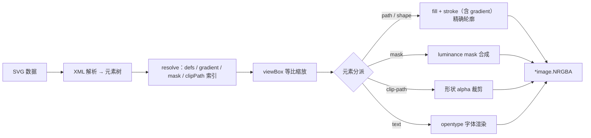

<p align="center">
  <b>gosvg</b><br/>
  纯 Go 的轻量 SVG 子集渲染器，零 cgo，把常见 SVG 场景渲染成位图<br/><br/>
  
  
  
</p>

<p align="center">
  <a href="#快速开始">快速开始</a> ·
  <a href="#特性">特性</a> ·
  <a href="#工作原理">工作原理</a> ·
  <a href="#字体">字体</a> ·
  <a href="#对账">对账</a> ·
  <a href="#仓库结构">仓库结构</a>
</p>

---

纯 Go 的轻量级 SVG 子集渲染器：零 cgo，唯一直接依赖 `golang.org/x/image`（Go 官方扩展库）。定位是「够用的 SVG 子集」而非完整实现——覆盖 **circle-flags 圆形国旗**、**Lucide 线条图标**、**带文字的图标**这三类最常见的实际场景，渲染成 `*image.NRGBA` 位图。

## 快速开始

```sh
go get github.com/Blue-Mink/gosvg
```

> [!NOTE]
> 当前源码托管在内网 Gitea（`https://github.com/Blue-Mink/gosvg`），
> module 路径保留 `github.com/Blue-Mink/gosvg` 以便未来开源。内网/本地使用请在
> 调用方 `go.mod` 里加 `replace github.com/Blue-Mink/gosvg => <本地路径>`，
> 或配合 `GOPRIVATE` 使用；仓库尚未推送到 GitHub 时 `go get` 不可用。

```go
import "github.com/Blue-Mink/gosvg"

svg := []byte(`<svg viewBox="0 0 24 24">
  <path fill="none" stroke="#000" stroke-width="2" d="M5 12h14M12 5l7 7-7 7"/>
</svg>`)

img, err := gosvg.Render(svg, 512) // 512×512 透明底 NRGBA
```

主要 API：

| 函数 | 说明 |
|:--|:--|
| `Render(data []byte, size int)` | 渲染成 `size×size` 位图 |
| `RenderTo(data []byte, w, h int)` | 渲染成指定宽高 |
| `Parse(data []byte)` | 解析为可复用的 `*Document` |
| `(*Document).Render(w, h int)` | 对已解析文档多次渲染 |
| `AddFontDir(dir string) error` | 注册系统字体目录（可选，见[字体](#字体)） |
| `MeasureText(text string, fontSize float64, fontFamily string) float64` | 测量文本宽度（用户单位），用于手动布局/居中 |
| `MeasureTextEx(text, fontSize, family, weight, style)` | 带 font-weight/font-style 的文本测量 |
| `ImageDecoder func(href string) (image.Image, error)` | 覆盖 `<image>` 位图解码；未注入时仅 `data:` URI 由内置解码，其余 href 静默跳过 |
| `RenderWithOptions(ctx, data, w, h, opts)` | 带取消 / 尺寸上限 / 背景色的渲染入口 |
| `RenderOptions{MaxDimension, Background}` | 渲染选项；`DefaultRenderOptions()` 取默认值 |
| `(*Document).RenderWithOptions(ctx, w, h, opts)` | 已解析文档带选项渲染 |
| `(*Document).Diagnostics() []string` | 渲染期跳过事件（去重、累计），用于排查「少了一块」 |
| `(*Document).LastRenderDiagnostics() []string` | 最近一次渲染的跳过事件（每次渲染重置） |
| `DefaultImageDecoder()` | 零外部依赖、供显式注入的安全 `<image>` 解码器（标准库 PNG/JPEG/GIF，**仅 `data:` URI**）；不会自动生效，不读本地文件、不抓取远程 URL，见 `SECURITY.md` |
| `LocalFileImageDecoder(roots...)` | 显式允许读本地文件路径的解码器；`roots` 为白名单目录（解析 `..`/symlink 防越界），不传则允许任意路径（仅可信输入），见 `SECURITY.md` |
| `RenderOptions.ImageDecoder` | 逐渲染注入解码器，避免包级全局状态 |
| `RegisteredFonts() []string` | 已注册系统字体族（排序后的副本） |
| `ResetFonts()` | 清空 `AddFontDir` 注册，用于测试隔离 |
| `ErrorCode` / `ErrEmptyDocument` 等 | `UnsupportedError` 的机器可读分类与 `errors.Is` 哨兵 |
| `RenderToWriter(w, data, width, height, format, opts)` | 渲染并按 `png` / `jpeg` 编码写入 `io.Writer` |
| `EncodeImage(w, img, format, quality, bg)` | 编码位图；JPEG 无 alpha，自动合成到 `bg`（默认白） |

## 特性

**元素**：`svg` / `g` / `defs` / `use` / `linearGradient` / `radialGradient` / `stop` / `clipPath` / `circle` / `ellipse` / `rect` / `line` / `path` / `polygon` / `polyline` / `text` / `tspan` / `mask` / `marker` / `image` / `pattern` / `style`

**属性**：`viewBox` / `preserveAspectRatio` / `transform` / `fill` / `fill-rule` / `fill-opacity` / `stroke` / `stroke-width` / `stroke-linecap` / `stroke-linejoin` / `stroke-miterlimit` / `stroke-dasharray` / `stroke-dashoffset` / `stroke-opacity` / `opacity` / `gradientUnits` / `gradientTransform` / `spreadMethod` / `offset` / `stop-color` / `stop-opacity` / `mask` / `maskUnits` / `maskContentUnits` / `clip-path` / `clipPathUnits` / `marker-start` / `marker-mid` / `marker-end` / `markerUnits` / `markerWidth` / `markerHeight` / `refX` / `refY` / `orient` / `font-size` / `font-family` / `font-weight` / `font-style` / `text-anchor` / `dominant-baseline` / `x` / `y` / `dx` / `dy` / `color` / `currentColor` / `id` / `class` / `display` / `visibility` / `clip-rule` / 内联 `style`

**CSS**：支持 `<style>` 样式表元素与 class/id/类型选择器（含 `tag.class#id` 组合与逗号分隔），按 CSS 特异性级联；优先级 presentation 属性 < CSS 规则 < 内联 `style`。

**颜色**：`#rgb` / `#rrggbb` / `#rgba` / `#rrggbbaa`、`rgb()` / `rgba()`、`hsl()` / `hsla()`（逗号或空格分隔，含 `/` 分隔 alpha）、SVG/CSS 命名颜色、`none`、`currentColor`。

> [!NOTE]
> **明确不支持**（命中时静默跳过，不报错）的特性清单：
>
> - **元素/特性**：`filter`、`textPath`、`foreignObject`、`symbol`/`view`、
>   `switch`/`requiredFeatures`、动画与脚本、`mask-type="alpha"`、
>   `vector-effect`（含 `non-scaling-stroke`）、`marker orient="auto-start-reverse"`、
>   `radialGradient` 的 `fx/fy/fr`、`mix-blend-mode`/`isolation`、
>   `letter-spacing`/`word-spacing`/`text-decoration`、`use` 的 `width/height`、
>   `<image>` 自身的 `preserveAspectRatio`（按 x/y/w/h 拉伸）
> - **CSS**：后代/子代/兄弟选择器、伪类/伪元素、`@media`/`@import`/`@supports`、
>   `!important`、`var()`/`calc()`、`inherit`、CSS4 颜色（`lab()`/`lch()`/`color()`）
> - **长度**：根 `<svg>` 的 `width`/`height` 按 **96dpi 换算物理单位**（mm/cm/in/pt/pc/q）；
>   其余长度（元素几何 / font-size / stroke-width 等）仍统一剥离后按数值 **1:1 近似**，
>   `%` 与相对单位（em/ex/rem）不按父值/视口基准解析
> - **字体**：`.ttc` 集合；未调用 `AddFontDir` 时 `font-family` 一律回退 Go Regular
> - **`<image>`**：`data:` URI 在**未注入任何解码器**时也由内置 `decodeDataURIOnly`
>   用标准库解码（PNG/JPEG/GIF，不碰文件与网络）；本地路径 / 远程 URL 必须显式注入
>   包级 `ImageDecoder` 或 `RenderOptions.ImageDecoder`，否则静默跳过（记入 `Diagnostics()`）。
>   `DefaultImageDecoder()` 自 v0.2.4 起**只解 `data:` URI**，不读本地文件。仍需读
>   本地路径时显式改用 `LocalFileImageDecoder(allowedRoots...)`，其中 `allowedRoots`
>   是路径白名单（解析 `..` 与符号链接防越界）；不传则允许任意路径，仅限可信输入。
>   见 `SECURITY.md`。
>
> 完整清单与已知边界见 [GOSVG_TODO.md](GOSVG_TODO.md)；渲染期跳过事件可用
> `Document.Diagnostics()` / `LastRenderDiagnostics()` 观察（非穷尽）。

> [!NOTE]
> **输入与资源限制**：单次 `Parse` 的 SVG ≤ `MaxSVGSize`（8 MiB）、元素数 ≤
> `MaxElementCount`（10 万）、XML 嵌套深度 ≤ `MaxXMLDepth`（256）；渲染尺寸 ≤
> `DefaultMaxDimension`（8192）、mask/clip 离屏嵌套 ≤ 32。超限返回 `UnsupportedError`，
> 可用 `errors.Is` 判断 `ErrInputTooLarge` / `ErrTooManyElements` / `ErrNestingTooDeep` /
> `ErrDimensionExceeded` / `ErrNonPositiveSize` / `ErrEmptyDocument`。
> `<style>` 的 CSS 另有 `MaxCSSRules` / `MaxCSSSelectorLen` / `MaxCSSDeclLen`，
> 超限内容被丢弃（降级而非失败）并记入 `Diagnostics()`。

## 工作原理



**一句话总结**：解析成元素树 → 按 `viewBox` 建立坐标系 → 形状走 fill/stroke 光栅化、`<mask>` 做亮度合成、`<text>` 用字体渲染，三者汇到同一张位图。stroke 采用「每条线段独立生成胶囊体 + non-zero 累积」的精确轮廓方案，小半径弧的内偏移退化天然免疫。

## 字体

默认用内置 Go Regular 字体（零外部依赖）。如需对齐系统字体（如 DejaVu），可选注册字体目录：

```go
gosvg.AddFontDir("/usr/share/fonts/truetype/dejavu")
```

之后 `font-family`（含 CSS 通用名 `sans-serif`/`serif`/`monospace` 与逗号列表）会命中对应字型，`font-weight`/`font-style` 择优；未命中回退内置字体。不调用 `AddFontDir` 则保持零依赖行为不变。

## 对账

与 cairosvg 在 512×512 下的 IoU（越接近 1 越一致）：

| 场景 | IoU |
|:--|:--|
| 圆形国旗（26 国，fill + mask） | 0.9998 |
| Lucide 线条图标（rock / country / blues / jazz） | 0.9946–0.9985 |
| 年代唱片标签（text） | 目视字形一致（无逐像素基线，字体栅格化差异属已知边界） |

剩余差异为光栅器 AA 与 cairosvg 的亚像素舍入差，肉眼不可辨。

## 仓库结构

```
gosvg.go            主 API（Render / RenderTo / Parse / Document）
parser.go           SVG 解析 → 元素树
path.go             path d 解析 → vector path
shape.go            基本形状（circle / ellipse / rect / line / polygon / polyline）
stroke.go           stroke 精确轮廓
dash.go             stroke-dasharray / dashoffset
mask.go             luminance mask 合成
clip.go             clip-path 形状 alpha 裁剪
gradient.go         linear / radial 渐变（fill 与 stroke 均支持）
text.go             text / tspan 渲染
font.go             字体（内置 Go Regular + 可选系统字体）
style.go            颜色 / 长度 / 内联样式解析
transform.go        transform / viewBox
internal/rasterx    fork 自 rasterx（fill 扫描器）
internal/vector     fork 自 x/image/vector（AA 光栅器，已扩展 even-odd winding）
cmd/render          CLI 渲染器
cmd/verify          CLI 校验（渲染 + 可选 PNG 输出）
cmd/corpus          真实语料成功率回归
cmd/iou             像素 IoU 对账（cairosvg 参照图 / 两种 alpha 口径 / 基线对比）
testdata/           对账测试样例
```

## 开发

```sh
sh ./scripts/verify.sh   # 全套：go mod verify / tidy -diff / fmt / vet / test(cover)
                         #   / -race / arm64 / wasm / bench / 6 个 fuzz 目标
go test ./...      # 单元 + 回归 + golden 像素哈希基线（testdata 自动枚举）
go test -race ./...
go vet ./...
gofmt -l .         # 无输出 = 通过
GOARCH=arm64 GOOS=linux go build ./...
GOOS=js GOARCH=wasm go build ./...
# ⚠️ 仅当「有意改变渲染输出」时；该 flag 跳过全部比对并直接覆盖基线，常规开发/CI 绝不传：
go test -run TestGoldenRegression -update .
```

若 `proxy.golang.org` 不通，用 `GOPROXY=https://goproxy.cn,direct`。
更多见 [CONTRIBUTING.md](CONTRIBUTING.md) 与 [GOSVG_TODO.md](GOSVG_TODO.md)。

## 性能

`BenchmarkRender`（512×512，Lucide 线条图标）在 .15 / Go 1.27.3 / Ryzen 7 5825U 上实测
约 **8.9 ms/op**（同机多次 8.9–11.2 ms）、**5.37 MB/op**、**292,168 allocs/op**。
`Parse` 仅约 3.5 µs，复用 `Document` 收益可忽略；数字与机器强相关，仅作同一台机器上的
相对基线，详见 [BENCHMARK.md](BENCHMARK.md)。

## 真实语料实测

用 `cmd/corpus` 对 .15 上 **958 个真实世界 SVG**（fnOS 面板图标、node_modules 图标库、
应用配置、混合来源）批量渲染：

| 语料 | 数量 | 渲染出内容 |
|---|---|---|
| fnOS 面板图标 | 217 | **100%** |
| node_modules 图标库 | 355 | 99.7% |
| 应用配置 | 127 | **100%** |
| 混合来源 | 259 | 99.2% |
| **合计** | **958** | **99.7%** |

剩余 3 个「全透明」经逐个核查均为语料本身的空 SVG（`empty.svg`、`annotation-noicon.svg`×2），
即**可渲染的 SVG 失败数为 0**。

Parse / Render 崩溃数为 0。基线数据、剩余 3 个全透明样例的逐个定位与复现方式见
[CORPUS_BASELINE.md](CORPUS_BASELINE.md)。

```sh
go run ./cmd/corpus -size 64 <dir>...   # 文本报告
go run ./cmd/corpus -json <dir>...      # JSON，便于做基线 diff
```

## 与 cairosvg 对账

> **口径**：`CAIROSVG_IOU.md` 的历史表格以 `alpha > 8` 判不透明；仓库外全量对账脚本
> 用 `alpha > 0`（对极淡 AA 像素更敏感）。两套数字**不可直接横比**。

**复算工具**（v0.2.4 起随仓库提供，取代仓库外一次性脚本）：

```sh
# 参照图目录（如 cairosvg 输出）与 SVG 目录按同名 stem 配对
go run ./cmd/iou -ref /path/to/cairo_png -svg /path/to/svg -size 256
# 报告正文的 alpha>8 口径
go run ./cmd/iou -ref /path/to/cairo_png -svg /path/to/svg -alpha 8
# 只看低分文件 / 导出完整 JSON / 与基线比提升-退化
go run ./cmd/iou -ref /path/to/cairo_png -svg /path/to/svg -min 0.5 -json iou.json
go run ./cmd/iou -ref /path/to/cairo_png -svg /path/to/svg -baseline /path/to/old_png
```

工具默认 `alpha > 0`（与上面全量数字同口径），`-alpha 8` 切换到
`CAIROSVG_IOU.md` 正文口径；两者**不可直接横比**。`-out` 可同时落盘渲染 PNG。
当前 main 用该工具复算得 `average IoU = 0.963860` / `IoU<0.5 = 1` / 848 个可比样本，
与上表逐位一致。

**当前结论（v0.2.3，全量 848 个可对比样本 / 256×256，`alpha > 0` 口径）**：
平均 alpha IoU **0.963860**，`IoU<0.5` 仅 **1** 个。演进：`0.949874`（even-odd 修复前）
→ `0.961272`（PR #17）→ `0.963860`（PR #18）。v0.2.3 已在独立沙箱复现 848/848
逐像素一致。详见 `CHANGELOG.md` [v0.2.3] 与 `CAIROSVG_IOU.md` 修正 6 / 7 / 8。

<details>
<summary>历史抽样结论（117 个，已由全量对账取代）</summary>

对 117 个真实语料抽样（256×256）算 alpha IoU：**中位 0.9982**、平均 0.8266、
≥0.99 的有 85 个。低分集中在 `stroke-width:.25` 的**亚像素细线** + `<text>` 字体差异
（与「45° 斜线 AA 相位歧义」同源的已定案边界），重叠区 RGB 平均差仅 3–7，
属「画在同一处但 AA/字形不同」而非语义错误。完整方法、分布与根因分类见
[CAIROSVG_IOU.md](CAIROSVG_IOU.md)。

</details>

> `cmd/corpus` 的成功率只能回答「有没有画出东西」，对账才能回答「画得对不对」——
> 本轮就是靠对账定位到一个成功率完全看不到的真 bug（clip/mask 与 transform 的求值顺序）。

## 📄 许可证

本项目自研代码遵循 [MIT License](LICENSE) 许可证。

第三方 fork 代码保留各自原始版权与许可：

- `internal/rasterx` —— fork 自 [srwiley/rasterx](https://github.com/srwiley/rasterx)，MIT，© 2018 the rasterx Authors，见 `internal/rasterx/LICENSE`
- `internal/vector` —— fork 自 [`golang.org/x/image/vector`](https://pkg.go.dev/golang.org/x/image/vector)，BSD-3-Clause，© The Go Authors，见 `internal/vector/LICENSE`

---

## 🙏 致谢

- [golang.org/x/image](https://pkg.go.dev/golang.org/x/image) —— font / vector 底层实现
- [srwiley/rasterx](https://github.com/srwiley/rasterx) —— fill 扫描器 fork 来源
- [tdewolff/canvas](https://github.com/tdewolff/canvas) —— stroke-dasharray 等算法参考
- [cairosvg](https://cairosvg.org) —— 渲染对账基准

---

<div align="center">

**如果觉得好用，顺手点个 ⭐ Star 支持一下！**

Made with ❤️ by [Blue-Mink](https://github.com/Blue-Mink)

</div>
