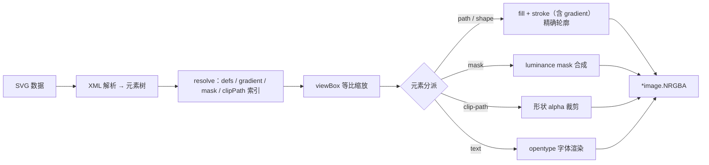

<p align="center">
  <b>gosvg</b><br/>
  纯 Go 的轻量 SVG 子集渲染器，零 cgo，把常见 SVG 场景渲染成位图<br/><br/>
  
  
  
</p>

<p align="center">
  <a href="#快速开始">快速开始</a> ·
  <a href="#特性">特性</a> ·
  <a href="#工作原理">工作原理</a> ·
  <a href="#字体">字体</a> ·
  <a href="#对账">对账</a> ·
  <a href="#仓库结构">仓库结构</a>
</p>

---

纯 Go 的轻量级 SVG 子集渲染器：零 cgo，唯一直接依赖 `golang.org/x/image`（Go 官方扩展库）。定位是「够用的 SVG 子集」而非完整实现——覆盖 **circle-flags 圆形国旗**、**Lucide 线条图标**、**带文字的图标**这三类最常见的实际场景，渲染成 `*image.NRGBA` 位图。

## 快速开始

```sh
go get github.com/Blue-Mink/gosvg
```

```go
import "github.com/Blue-Mink/gosvg"

svg := []byte(`<svg viewBox="0 0 24 24">
  <path fill="none" stroke="#000" stroke-width="2" d="M5 12h14M12 5l7 7-7 7"/>
</svg>`)

img, err := gosvg.Render(svg, 512) // 512×512 透明底 NRGBA
```

主要 API：

| 函数 | 说明 |
|:--|:--|
| `Render(data []byte, size int)` | 渲染成 `size×size` 位图 |
| `RenderTo(data []byte, w, h int)` | 渲染成指定宽高 |
| `Parse(data []byte)` | 解析为可复用的 `*Document` |
| `(*Document).Render(w, h int)` | 对已解析文档多次渲染 |
| `AddFontDir(dir string) error` | 注册系统字体目录（可选，见[字体](#字体)） |
| `MeasureText(text string, fontSize float64, fontFamily string) float64` | 测量文本宽度（用户单位），用于手动布局/居中 |
| `MeasureTextEx(text, fontSize, family, weight, style)` | 带 font-weight/font-style 的文本测量 |
| `ImageDecoder func(href string) (image.Image, error)` | 注入 `<image>` 位图解码（库零依赖，未注入则 `<image>` 跳过） |

## 特性

**元素**：`svg` / `g` / `defs` / `use` / `linearGradient` / `radialGradient` / `stop` / `clipPath` / `circle` / `ellipse` / `rect` / `line` / `path` / `polygon` / `polyline` / `text` / `tspan` / `mask` / `marker` / `image` / `style`

**属性**：`viewBox` / `preserveAspectRatio` / `transform` / `fill` / `fill-rule` / `fill-opacity` / `stroke` / `stroke-width` / `stroke-linecap` / `stroke-linejoin` / `stroke-miterlimit` / `stroke-dasharray` / `stroke-dashoffset` / `stroke-opacity` / `opacity` / `gradientUnits` / `gradientTransform` / `spreadMethod` / `offset` / `stop-color` / `stop-opacity` / `mask` / `maskUnits` / `maskContentUnits` / `clip-path` / `clipPathUnits` / `marker-start` / `marker-mid` / `marker-end` / `markerUnits` / `markerWidth` / `markerHeight` / `refX` / `refY` / `orient` / `font-size` / `font-family` / `font-weight` / `font-style` / `text-anchor` / `dominant-baseline` / `x` / `y` / `dx` / `dy` / `color` / `currentColor` / `id` / `class` / 内联 `style`

**CSS**：支持 `<style>` 样式表元素与 class/id/类型选择器（含 `tag.class#id` 组合与逗号分隔），按 CSS 特异性级联；优先级 presentation 属性 < CSS 规则 < 内联 `style`。

**颜色**：`#rgb` / `#rrggbb` / `#rgba` / `#rrggbbaa`、`rgb()` / `rgba()`、`hsl()` / `hsla()`（逗号或空格分隔，含 `/` 分隔 alpha）、SVG/CSS 命名颜色、`none`、`currentColor`。

> [!NOTE]
> **明确不支持**（命中时静默降级，不报错）：`mask-type="alpha"`。CSS 仅支持简单选择器（类型/class/id 及其组合），不支持后代/子代/伪类选择器与 `@media`/`@import`。

## 工作原理



**一句话总结**：解析成元素树 → 按 `viewBox` 建立坐标系 → 形状走 fill/stroke 光栅化、`<mask>` 做亮度合成、`<text>` 用字体渲染，三者汇到同一张位图。stroke 采用「每条线段独立生成胶囊体 + non-zero 累积」的精确轮廓方案，小半径弧的内偏移退化天然免疫。

## 字体

默认用内置 Go Regular 字体（零外部依赖）。如需对齐系统字体（如 DejaVu），可选注册字体目录：

```go
gosvg.AddFontDir("/usr/share/fonts/truetype/dejavu")
```

之后 `font-family`（含 CSS 通用名 `sans-serif`/`serif`/`monospace` 与逗号列表）会命中对应字型，`font-weight`/`font-style` 择优；未命中回退内置字体。不调用 `AddFontDir` 则保持零依赖行为不变。

## 对账

与 cairosvg 在 512×512 下的 IoU（越接近 1 越一致）：

| 场景 | IoU |
|:--|:--|
| 圆形国旗（26 国，fill + mask） | 0.9998 |
| Lucide 线条图标（rock / country / blues / jazz） | 0.9946–0.9985 |
| 年代唱片标签（text） | 字形一致（DejaVu 对齐） |

剩余差异为光栅器 AA 与 cairosvg 的亚像素舍入差，肉眼不可辨。

## 仓库结构

```
gosvg.go            主 API（Render / RenderTo / Parse / Document）
parser.go           SVG 解析 → 元素树
path.go             path d 解析 → vector path
shape.go            基本形状（circle / ellipse / rect / line / polygon / polyline）
stroke.go           stroke 精确轮廓
dash.go             stroke-dasharray / dashoffset
mask.go             luminance mask 合成
clip.go             clip-path 形状 alpha 裁剪
gradient.go         linear / radial 渐变（fill 与 stroke 均支持）
text.go             text / tspan 渲染
font.go             字体（内置 Go Regular + 可选系统字体）
style.go            颜色 / 长度 / 内联样式解析
transform.go        transform / viewBox
internal/rasterx    fork 自 rasterx（fill 扫描器）
internal/vector     fork 自 x/image/vector（AA 光栅器，已扩展 even-odd winding）
cmd/render          CLI 渲染器
cmd/verify          CLI 校验
testdata/           对账测试样例
```

## 开发

```sh
go test ./...      # 单元 + 回归测试
go vet ./...       # 静态检查
gofmt -l .         # 格式检查（无输出 = 通过）
```

## 📄 许可证

本项目自研代码遵循 [MIT License](LICENSE) 许可证。

第三方 fork 代码保留各自原始版权与许可：

- `internal/rasterx` —— fork 自 [srwiley/rasterx](https://github.com/srwiley/rasterx)，MIT，© 2018 the rasterx Authors，见 `internal/rasterx/LICENSE`
- `internal/vector` —— fork 自 [`golang.org/x/image/vector`](https://pkg.go.dev/golang.org/x/image/vector)，BSD-3-Clause，© The Go Authors，见 `internal/vector/LICENSE`

---

## 🙏 致谢

- [golang.org/x/image](https://pkg.go.dev/golang.org/x/image) —— font / vector 底层实现
- [srwiley/rasterx](https://github.com/srwiley/rasterx) —— fill 扫描器 fork 来源
- [tdewolff/canvas](https://github.com/tdewolff/canvas) —— stroke-dasharray 等算法参考
- [cairosvg](https://cairosvg.org) —— 渲染对账基准

---

<div align="center">

**如果觉得好用，顺手点个 ⭐ Star 支持一下！**

Made with ❤️ by [Blue-Mink](https://github.com/Blue-Mink)

</div>
